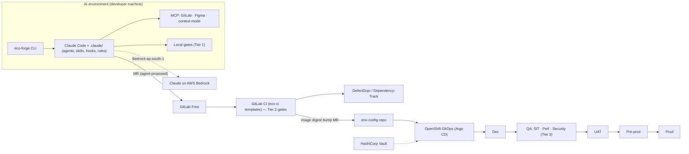

# eco-forge — Design Specification

| | |
|---|---|
| **Package** | `@yourorg/eco-forge` |
| **Status** | DRAFT — for review |
| **Date** | 2026-10-18 |
| **Owner** | Paresh Patil |
| **Scope** | Phase 1 (delivered as milestones M1–M5) |

---

## 1. Purpose

eco-forge is an npm package that installs and configures an opinionated, agentic software-delivery ecosystem around **Claude Code**. One command (`npx @yourorg/eco-forge init`) gives every team member the same setup to:

1. Turn BRDs, notes and Figma designs into **deep, gap-free product specifications** through a structured interview.
2. Generate **BRD, PRD, HLD, LLD, technical, integration, API and UAT documents** from one traceable source.
3. Write **high-quality Spring Boot + Angular code** with role-based agents, test-first.
4. Enforce **quality gates**: corner cases, NFRs, performance, accessibility, and security (SAST, DAST, pen testing, OWASP ASVS L2, secure file upload, DPDP Act).
5. Deliver through **GitLab → OpenShift GitOps** across all environments.
6. Do all of this with **the fewest tokens possible**, proven by measurement.

### Non-goals (Phase 1)

- Replacing human sign-offs (spec, design, security, UAT, production).
- Certifying legal/DPDP compliance. eco-forge produces evidence; legal signs off.
- Matching Coverity exactly with open-source tools. We measure how close we get (see §15).
- Multi-harness support (Goose etc.) and external swarm orchestrators (Ruflo/Paperclip). These are later adapters.

---

## 2. Decisions log

| # | Decision | Choice |
|---|---|---|
| D1 | Target stack | Spring Boot 4, Java 21, Maven, Angular, Oracle (Dev onwards), H2/embedded Postgres (AI env), Kafka, in-house IdP |
| D2 | Third-party tools | Curated bundle: one pinned default per layer, the rest as opt-in adapters |
| D3 | Docs home | Markdown in the repo (docs-as-code), exported to DOCX/PDF for business sign-off |
| D4 | Runtime | Claude Code native (subagents, skills, commands, hooks, MCP) |
| D5 | Spec workflow | Our own `/eco:*` commands (inspired by Spec Kit, no Python dependency) |
| D6 | Clarification | Live one-question-at-a-time interview in chat, persisted to `questions.md` |
| D7 | SCM / CI | Self-managed GitLab **Free**, GitLab CI, open-source scanners only |
| D8 | Deploy | OpenShift GitOps (Argo CD), Helm, HashiCorp Vault |
| D9 | Environments | AI → Dev → QA (SIT, Perf, Security) → UAT → Pre-prod → Prod |
| D10 | Compliance | OWASP ASVS L2, OWASP Top 10, secure coding practices, secure file upload, SAST, DAST, pen testing, DPDP Act (PII handling, consent, retention) |
| D11 | Gate strictness | Blocking, with documented waivers that need a named approver |
| D12 | LLM route | AWS Bedrock, **ap-south-1 only** (India data residency) |
| D13 | Memory | Repo-as-memory + one per-developer store; Graphiti later |
| D14 | CI autonomy | Agents propose (commits/MRs), humans merge |
| D15 | Rollout | Per-developer install first; centralise on a server later |
| D16 | Workstations | Windows and Linux; internet via proxy; npm/Maven via Nexus |
| D17 | Codebases | Greenfield **and** brownfield |
| D18 | Phase 1 scope | Everything above, including DAST/pen testing/DefectDojo/DPDP and Argo CD multi-environment promotion |

---

## 3. Constraints and their consequences

| Constraint | Consequence for the design |
|---|---|
| GitLab Free | No epics, required approvals or security dashboard. We use milestones + `parent::#id`, protected branches + a `gate-policy` CI job, and **DefectDojo** + **Dependency-Track** as the findings system of record. |
| Bedrock ap-south-1 only | Model routing must use only Claude models available **in-region** (no cross-region inference profiles). M1 must verify the model list in your AWS account; agent model tiers adapt to it. |
| Windows + Linux | All hooks and scripts are written in Node (no bash). Linux-first scanners (e.g. Infer) run in the `eco-devbox` container (WSL2/Podman on Windows). **CI is the authoritative gate.** |
| Proxy + Nexus | The CLI honours `HTTPS_PROXY`/`NO_PROXY` and an npm/Maven registry override. Scanner rule/DB updates go through the proxy or are pre-baked into `eco-devbox`. |
| Oracle from Dev, H2/Postgres in AI env | Risk of SQL dialect differences (§8.3). Migrations and repository tests always run against **Oracle Free (Testcontainers)** in CI. |
| DPDP + Bedrock | No real PII may reach the LLM. Enforced by a PII guard hook and synthetic-only test data (§14.3). |

---

## 4. Architecture overview



**Layers:** 0 Installer · 1 Spec & discovery · 2 Design review · 3 Build · 4 Quality gates · 5 Memory · 6 Token efficiency · 7 Control & guardrails · 8 Work management (GitLab) · 9 Delivery (OpenShift).

---

## 5. Package and distribution (Layer 0)

### 5.1 CLI

| Command | Purpose |
|---|---|
| `eco-forge init [--profile springboot-angular] [--brownfield]` | Detects the repo, writes all managed files, configures Bedrock, MCP and hooks |
| `eco-forge doctor` | Checks versions (Claude Code, Java, Maven, Node, oc, helm, scanners), proxy and Nexus reachability, Bedrock access and model availability, MCP health |
| `eco-forge upgrade [--channel stable\|next]` | Upgrades managed files with a three-way merge; refuses incompatible combinations |
| `eco-forge add <module>` | Adds optional modules (e.g. `file-upload`, `dpdp`, `kafka`, `memory-hindsight`) |
| `eco-forge eject` | Removes the hash markers; the team owns the files from then on |
| `eco-forge bench` | Runs the token/quality benchmark (§15.5) |

### 5.2 Contents

```
@yourorg/eco-forge
├─ bin/eco-forge.js
├─ profiles/springboot-angular/          (springboot-react: later)
├─ templates/
│  ├─ claude/   agents/ skills/ commands/ hooks/ rules/ output-styles/ settings.json .mcp.json CLAUDE.md
│  ├─ docs/     brd prd hld lld tech-spec integration api uat adr rca dpdp-notice ropa  (+ docx reference template)
│  ├─ gitlab/   issue_templates/ merge_request_templates/ labels.json .gitlab-ci.yml (include stubs)
│  ├─ deploy/   Dockerfile.backend Dockerfile.frontend helm/ argocd/ vault/
│  ├─ quality/  eco.gates.yaml semgrep/ zap/ nuclei/ k6/ checkstyle pmd spotbugs-exclude
│  └─ app/      Spring Boot 4 + Angular skeleton (greenfield), file-upload + dpdp modules
├─ scripts/     sarif-reduce trace-check pii-check gate-policy retention-check docs-export
└─ eco.lock     pinned versions of every bundled component
```

### 5.3 Companion repositories

| Repo | Purpose |
|---|---|
| `eco-ci` | Shared GitLab CI templates, included with `include: project:`. Fix a gate once and every repo gets it. |
| `eco-devbox` | UBI 9 image with pinned Java 21, Maven, Node, oc, helm, Semgrep, Infer, SpotBugs, Trivy, gitleaks, ZAP, k6, pandoc. Used on Windows (WSL2/Podman) and by CI runners. |
| `env-config` | Argo CD ApplicationSet and per-environment Helm values; promotion MRs land here. |

### 5.4 Version management and upgrades

Covers Claude Code and every bundled tool.

- **`eco.lock`** pins: the Claude Code version, MCP server versions (GitLab, Figma, context-mode), the memory plugin, scanner versions and rule-pack versions, the devbox image digest, and the `eco-ci` template tag.
- **Claude Code is pinned.** It is installed from Nexus at the pinned version, auto-update is disabled through settings/environment, and it moves forward only via `eco-forge upgrade`.
- **Release channels.** `next` is used by a canary group for one sprint. A release is promoted to `stable` only after the benchmark suite (§15) shows no quality or token regression.
- **Compatibility matrix.** A CI matrix tests each eco-forge release against the pinned Claude Code version and N-1. `doctor` warns when your local versions drift from `eco.lock`.
- **Managed files.** Each carries a hash header. `upgrade` overwrites untouched files, three-way merges edited ones, and never touches `.eco/overrides/`.
- **The package itself.** Semver; releases are signed; an SBOM is published to the GitLab npm registry (Nexus proxy); **no `postinstall` scripts**.

### 5.5 Centralisation path (later)

The same `eco.lock`, `managed-settings.json` and `eco-ci` templates are reused on a central server, with three changes:

- shared CI runners execute headless agents;
- memory moves to a shared Graphiti/Hindsight server;
- budgets become per team.

No redesign is needed. Only where the policy files are distributed changes.

---

## 6. Spec and discovery (Layers 1–2)

### 6.1 Pipeline

| Command | Agent(s) | Output (under `docs/specs/<feature>/`) | Gate |
|---|---|---|---|
| `/eco:intake` | product-analyst | `intake.md`: raw facts, every line citing its source | — |
| `/eco:figma` | ux-reviewer | `design-review.md`, `ui-inventory.md` | — |
| `/eco:clarify` | product-analyst, nfr-analyst, integration-analyst, privacy-reviewer | `questions.md` (live interview log) | No open **blocking** questions; every assumption approved |
| `/eco:spec` | product-analyst | `spec.md` (REQ-IDs, acceptance criteria), `nfr.md` (numeric targets), `data-catalog.md` (PII tags) | Spec sign-off (human) |
| `/eco:design` | solution-architect, integration-analyst | `hld.md`, `lld.md`, `integration.md`, `api/openapi.yaml`, `adr/*.md` | Design sign-off (human) |
| `/eco:plan` | delivery-planner | `tasks.md` → GitLab issues | — |
| `/eco:uat` | qa-uat-writer | `uat.md` (one or more cases per REQ-ID) | — |
| `/eco:export` | (script) | Branded DOCX/PDF of BRD, HLD, LLD, UAT, etc. | Business sign-off recorded on the GitLab issue |

`trace.md` is generated by script and lists REQ → design section → issue → test → UAT case → result.

### 6.2 Live clarify interview

- One question at a time, with multiple-choice answers where possible and a recommended default.
- Questions come from **fixed checklists**, so coverage doesn't depend on the model's mood:
  - **Functional:** actors and roles, main and alternate flows, validation, error paths, idempotency, data lifecycle, permissions per role, audit needs.
  - **NFR (ISO 25010):** each one must be numeric — latency percentiles at a stated load, throughput, availability, RPO/RTO, scalability, observability, WCAG 2.2 AA, browsers and locales.
  - **Integration:** contract, auth (in-house IdP), timeouts and retries, idempotency keys, ordering, DLQ, SLAs, versioning, Kafka topics and schemas.
  - **Security:** ASVS L2 chapters relevant to the feature; file upload (types, size, scanning).
  - **DPDP:** for every data field — PII class, purpose, consent basis, retention period, erasure trigger, cross-border flag.
  - **Figma vs spec:** screens missing for flows; states (empty, loading, error, disabled, partial); breakpoints; contrast and focus order; token mismatches.
- Each answer is written to `questions.md` immediately (Q-ID, question, answer, who answered, date), so sessions never re-ask and the record can be audited.

### 6.3 Figma path (decided by measurement)

Two routes are implemented and A/B-measured in M1 (§15.5). The cheaper one at equal quality becomes the default.

- **A. Figma MCP:** `get_design_context` / `get_metadata` / `get_variable_defs` on selected nodes only.
- **B. Export import:** design-token JSON (variables) + frame PNGs + a component inventory, read once into `ui-inventory.md`; later steps read the inventory, not Figma.

Developers have Figma seats, so A is always available as a fallback.

### 6.4 Brownfield onboarding — `/eco:onboard`

1. Reverse-engineer a module map, `hld.md`, `lld.md`, `openapi.yaml` from controllers, and `data-catalog.md` from entities (PII candidates flagged).
2. Generate `CLAUDE.md` and `.claude/rules/` from the actual conventions found.
3. Run the gates in **baseline mode**: existing findings are imported to DefectDojo as baseline, and **only new findings block**. A burn-down target is set per milestone.

---

## 7. Agent roster

Model tiers are placeholders until the ap-south-1 model list is verified (§3).

| Agent | Tier | Tools (allowlist) | Responsibility |
|---|---|---|---|
| product-analyst | High | Read, Write(docs/), AskUser | Intake, interview, spec |
| nfr-analyst | High | Read, Write(docs/) | Numeric NFRs |
| integration-analyst | High | Read, Write(docs/) | Contracts, Kafka, IdP |
| privacy-reviewer | High | Read, Write(docs/) | DPDP tagging and checks |
| ux-reviewer | Mid | Read, Figma MCP, Write(docs/) | Figma vs spec, a11y in design |
| solution-architect | High | Read, Write(docs/) | HLD, LLD, ADRs, OpenAPI |
| delivery-planner | Mid | Read, GitLab MCP | Tasks → issues |
| backend-dev | Mid | Read, Edit(src/main/java, src/test), Bash(mvn) | Spring Boot code, test-first |
| frontend-dev | Mid | Read, Edit(frontend/), Bash(npm) | Angular code, test-first |
| test-designer | Mid | Read, Edit(tests) | Boundary, property, contract, e2e tests |
| code-reviewer | High | Read only | Correctness and standards review |
| security-reviewer | High | Read only | OWASP/ASVS review of the diff |
| deep-taint-reviewer | High | Read only | Cross-file source→sink tracing on changed entry points |
| sast-triager | Low | Read(reduced SARIF) | De-duplicate and rank findings, propose fixes |
| perf-engineer | Mid | Read, Edit(perf/) | k6/Gatling from `nfr.md` |
| a11y-auditor | Low | Read, Bash(playwright/axe) | WCAG 2.2 AA |
| pentest-assistant | High | Read, Bash(zap, nuclei, sqlmap, ffuf) — **QA-Security only** | ASVS L2 test execution support |
| devops-engineer | Mid | Read, Edit(helm/, Dockerfile*, env-config) | Containers, Helm, Argo CD |
| qa-uat-writer | Mid | Read, Write(docs/) | UAT scripts |

Agent and skill content is curated from ECC and agency-agents where licences allow (attribution kept). Nothing is installed from them wholesale.

---

## 8. Build workflow (Layers 3 and 8)

### 8.1 GitLab work management (Free tier)

- **Issue templates:** Feature, Story, Bug, NFR, Spike, Security Finding, DPDP Request.
- **Labels:** `type::`, `status::`, `priority::`, `req::REQ-nnn`, `pii::yes`. A label-lint CI job keeps them consistent, since scoped labels are a paid feature.
- **Hierarchy:** milestones are releases; `parent::#id` links stories to features.
- **`/eco:dev #123`:**
  1. Read the issue and its spec slice.
  2. Create a branch.
  3. Write tests first, then the code.
  4. Run the Tier 1 gates.
  5. Open an MR from the template (trace + gate checklist).
  6. Update the issue status.
- **`/eco:bugfix #456`:** failing regression test → root-cause fix → MR → RCA note on the issue → `/eco:retro`.
- **`/eco:status`:** sprint/release report built from issues, MRs, gates and DefectDojo.

### 8.2 Coding standards (enforced by rules + gates)

- **Backend:** Spring Boot 4 / Java 21 / Maven.
  - layered packages, constructor injection, `record` DTOs
  - Bean Validation on every input
  - RFC 9457 problem-details errors
  - no field injection, no `catch (Exception)` that swallows errors
- **Security:**
  - Spring Security resource server, with an adapter for the in-house IdP (specs pending)
  - deny-by-default authorisation
  - method security for object-level checks (IDOR)
- **Kafka:** idempotent consumers (idempotency keys), DLQ topics, retry with backoff, schema contract tests.
- **Angular:**
  - standalone components, strict TypeScript
  - no `innerHTML` bypass, no `bypassSecurityTrust*` without a waiver
  - shared design-token SCSS from Figma variables
  - Angular CDK a11y primitives
- **Observability:** structured JSON logs with PII masking, Micrometer metrics, OpenTelemetry traces, health/readiness probes.

### 8.3 Database strategy (Oracle vs AI-environment DB)

- Flyway migrations are written for **Oracle** first.
- AI environment: H2 in Oracle mode or embedded Postgres, for fast startup only.
- Repository and migration tests always run against **Oracle Free via Testcontainers** — in CI always, and locally when Docker/Podman is available.
- A Semgrep rule flags native queries and vendor-specific SQL that have no Oracle-backed test.

---

## 9. Quality gates (Layer 4)

All thresholds live in **`eco.gates.yaml`**. A waiver needs a reason, an expiry and a named approver, and is enforced by the `gate-policy` job.

### 9.1 Tiers

| Tier | Where | Checks |
|---|---|---|
| 1 | Claude Code hooks + pre-commit (AI env) | Format (Spotless, Prettier), lint (Checkstyle, PMD, Error Prone + NullAway, angular-eslint), gitleaks, unit tests of changed modules |
| 2 | GitLab MR pipeline | All of Tier 1, plus: JUnit + Testcontainers (Oracle, Kafka); contract tests; JaCoCo coverage of changed code; PIT mutation testing (incremental); jqwik property tests; Angular unit tests + Stryker; Playwright e2e + axe; Lighthouse CI; SAST stack (§10.1); SCA + SBOM; Trivy image scan; hadolint, kube-linter, kubeconform, Checkov on rendered Helm; trace-check; pii-check; retention-check |
| 3 | QA environments | SIT e2e; k6/Gatling against `nfr.md` thresholds (QA-Perf); ZAP full + API scan, Nuclei, pen-test checklist, DPDP checks (QA-Security) |

### 9.2 Default thresholds

These are starting values, tuned after the M1/M2 baseline.

| Gate | Default |
|---|---|
| Changed-line coverage | ≥ 80% |
| Mutation score (changed code) | ≥ 60% |
| SAST / SCA / container / DAST | 0 new High/Critical; Medium needs triage within the SLA |
| Secrets | 0 |
| Accessibility | 0 serious/critical axe violations; Lighthouse a11y ≥ 95 |
| Performance | Every `nfr.md` target met at the stated load |
| Traceability | Every REQ-ID has ≥ 1 automated test and ≥ 1 UAT case |
| OpenShift | Non-root, arbitrary UID, read-only root filesystem, limits and probes set, no `latest` tags |

### 9.3 Keeping gate output small

Every scanner emits SARIF/JSON. `sarif-reduce` keeps only **new** findings (diffed against the baseline in DefectDojo), de-duplicates them across tools, and passes a compact, ranked list to `sast-triager`. Agents never read raw scanner output.

---

## 10. Security and compliance

### 10.1 SAST stack (open-source alternative to Coverity)

| Language | Tools |
|---|---|
| Java | Meta Infer (cross-function null/resource/thread-safety bugs); SpotBugs + FindSecBugs; Error Prone + NullAway; PMD; Semgrep CE (OWASP rules + eco-forge rules for Spring Security, file upload and DPDP logging); SonarQube Community Build for quality and duplication |
| Angular / TS | Semgrep CE, angular-eslint, `eslint-plugin-security`, `eslint-plugin-no-unsanitized` |
| Agent layer | `deep-taint-reviewer` on changed entry points: covers the cross-file taint tracking missing from the free tools |

**CodeQL is excluded:** its licence doesn't allow scanning private commercial code without GitHub Advanced Security. Parity with Coverity is **measured** on the OWASP Benchmark (§15.2), not assumed.

### 10.2 Supply chain, IaC and secrets

- Trivy (filesystem, image, config), OWASP Dependency-Check, Syft/CycloneDX SBOM → Dependency-Track.
- Checkov, kube-linter and gitleaks.
- Base images: Red Hat UBI 9 from your registry mirror only.

### 10.3 DAST and pen testing (QA-Security)

- ZAP baseline, API scan driven by `openapi.yaml`, and an authenticated full scan using IdP test users.
- Nuclei, plus targeted sqlmap/ffuf.
- `pentest-assistant` works through an ASVS L2 checklist and records evidence per item.
- **Scope lock:** these tools can run only against QA-Security hosts listed in `eco.gates.yaml`; the guard hook blocks any other target.
- **A human pen tester signs off.**

### 10.4 Findings management

DefectDojo collects all findings (SLA tracking, waivers, baselines), and Dependency-Track monitors SBOMs continuously. Both run in a tools namespace on OpenShift.

### 10.5 Secure file upload module (`eco-forge add file-upload`)

Implements the OWASP File Upload Cheat Sheet:

- extension allowlist plus magic-byte checks (Apache Tika)
- size and count limits, zip-bomb/decompression limits
- random server-side file names, stored outside the web root (object store or DB)
- ClamAV scanning (clamd sidecar or service) with quarantine
- image re-encoding to strip metadata and polyglots
- `Content-Disposition: attachment`, `X-Content-Type-Options: nosniff`
- per-user authorisation on download

It ships with an attack-case test suite: polyglot, double extension, SVG with script, oversized file, zip bomb, path traversal in file names.

### 10.6 DPDP module (`eco-forge add dpdp`)

- **Spec time:** `data-catalog.md` tags every field (PII class, purpose, consent basis, retention, erasure trigger).
- **Code:**
  - consent ledger (per purpose, versioned notice)
  - `@Pii` annotation driving log masking, field-level encryption (keys in Vault) and export filtering
  - scheduled retention/erasure jobs with an audit trail
  - data principal APIs: access, correction, erasure, grievance, nominee
  - breach-notification runbook hook
  - verifiable parental consent flag for children's data
- **Gate:** `retention-check` and `pii-check` fail the build if a catalogued PII field lacks masking, encryption or a retention rule, or if PII appears in log statements or test fixtures.
- **Evidence pack:** Record of Processing Activities (RoPA), consent/retention configuration, test evidence, DefectDojo export.
- Obligations are taken from the DPDP Act and the 2025 Rules. **Legal must confirm the exact obligations and retention periods.**

### 10.7 OWASP ASVS L2 mapping

`docs/compliance/asvs-l2.md` maps each ASVS requirement to its control: a rule, test, gate, or manual pen-test item. The release evidence pack is generated from it.

---

## 11. Delivery to OpenShift (Layer 9)

### 11.1 Per-service artifacts

- **Dockerfile:** multi-stage, UBI 9 base, non-root, arbitrary-UID safe (`chgrp 0` + `g=u`), read-only root filesystem, no shell in the runtime image where possible.
- **Helm chart:**
  - Deployment, Service, Route (TLS edge/reencrypt)
  - HPA, PDB, NetworkPolicy (default deny)
  - ConfigMap
  - ServiceAccount
  - probes, resource limits, `securityContext` aligned with `restricted-v2` SCC
- **Values files:** `values.yaml` + `values-{dev,sit,perf,sec,uat,preprod,prod}.yaml`.
- **Secrets:** from HashiCorp Vault via the Vault Secrets Operator or External Secrets Operator. Never in git or values files.

### 11.2 Environments and promotion

| Env | Purpose | Gate to enter |
|---|---|---|
| AI | Developer machine with eco-forge; build and local Tier 1 | — |
| Dev | Integration with the wider ecosystem; contract tests | MR merged, Tier 2 green |
| QA-SIT | System integration, e2e | Promotion MR |
| QA-Perf | Load/stress tests against `nfr.md` | Promotion MR |
| QA-Security | DAST, pen testing, DPDP checks | Promotion MR; **security sign-off to exit** |
| UAT | Business runs `uat.md`; sign-off per REQ-ID | QA sign-offs |
| Pre-prod | Prod-like smoke, rollback/DR drill | UAT sign-off |
| Prod | Same image digest as tested | Maintainer-approved MR on `env-config` (+ change ticket) |

- CI builds the image **once**, signs it, and pushes it by digest.
- Promotion is an MR to `env-config` that changes only the digest. Argo CD syncs it.
- Rollback is a revert MR.

---

## 12. Memory (Layer 5)

| Tier | Mechanism | Scope |
|---|---|---|
| Working | Short `CLAUDE.md` (an index, ~150 lines); path-scoped `.claude/rules/*.md` | Team (git) |
| Project | `docs/memory/{decisions,gotchas,glossary}.md`, `docs/adr/`, `docs/specs/`. Obsidian-compatible: open `docs/` as a vault. | Team (git) |
| Hindsight loop | `/eco:retro` after each MR or bug proposes lessons as an MR to `gotchas.md`; a human reviews | Team (git) |
| Personal recall | **claude-mem** (default) or **Hindsight** adapter. Must be verified to call only Bedrock ap-south-1, otherwise it is disabled. | Per developer |
| Later | Graphiti temporal knowledge graph (Neo4j) for many repos | Shared server |

---

## 13. Token efficiency (Layer 6)

| Technique | Mechanism | Phase 1 |
|---|---|---|
| Keep tool output out of context | context-mode MCP | On |
| Terse internal reports | Caveman-style output style for subagent→orchestrator messages only (never documents or code) | On |
| Model per task | Agent frontmatter `model:` per tier | On |
| Smaller inputs | Spec slicing by REQ-ID; SARIF reducer; skills loaded only when needed; MCP servers limited per profile; path-scoped rules | On |
| Prompt caching | Stable prompt prefixes (CLAUDE.md, rules, agent prompts) | On |
| Figma import vs MCP | Chosen by A/B (§6.3) | Measured |
| Compression proxy (Headroom) | Adds a hop in front of Bedrock, which complicates audit and residency | Later |
| Telemetry | Claude Code OpenTelemetry → Prometheus/Grafana: tokens and cost per agent, command, MR and developer | On |

**Rule:** every technique must show a net saving in tokens per passing task in the ablation study (§15.5), or it is removed.

---

## 14. Control and guardrails (Layer 7)

### 14.1 Policy

`managed-settings.json` is installed into the system policy location on each machine, so users can't override it.

- **Deny:**
  - reading `~/.kube`, `~/.aws`, Vault tokens, `.env*`, `*.pem`
  - `oc`/`kubectl` against anything but Dev
  - `git push --force`, branch deletion
  - `curl`/`wget` outside an allowlist
- **Ask:** dependency additions, CI file edits, Helm/Dockerfile edits (unless the agent is `devops-engineer`).
- **Per-agent tool allowlists:** see §7.

### 14.2 Hooks (Node, cross-platform)

| Hook | Purpose |
|---|---|
| `PreToolUse` guard | Second layer behind the deny rules; resolves `sh -c`, scripts and aliases |
| `UserPromptSubmit` + `PreToolUse` PII guard | Blocks Aadhaar/PAN/phone/email patterns and bulk data dumps from reaching Bedrock |
| `PostToolUse` Tier 1 runner | Formats and lints changed files |
| Audit logger | Every tool call → JSONL → shipped to the central log store (evidence for DPDP and security) |
| Budget guard | Per-session and per-CI-job turn/cost caps |

### 14.3 Data handling

- Real PII never enters prompts. Test data comes only from synthetic generators: Indian-format valid-checksum fake Aadhaar/PAN numbers, marked as fake.
- `.claudeignore`-style deny rules exclude data dumps and production exports.

### 14.4 Bedrock configuration

- `init` sets `CLAUDE_CODE_USE_BEDROCK=1`, `AWS_REGION=ap-south-1`, the per-tier model IDs, and an SSO profile.
- `doctor` verifies that each configured model is invocable **in-region**.
- Cross-region inference profiles are blocked by policy.

### 14.5 Human approval points

1. Spec sign-off
2. Design sign-off
3. MR merge (Maintainer)
4. Security sign-off (QA-Security exit)
5. UAT sign-off per REQ-ID
6. Prod change approval

### 14.6 Headless agents in CI

`claude -p` jobs on GitLab runners using the `eco-devbox` image:

- **Gate auto-fix:** on a failed gate, push a fix commit to the MR branch, at most N attempts.
- **MR review:** code-reviewer and security-reviewer comment on the MR.

Agents never merge.

---

## 15. Verification and evaluation strategy

Every claim eco-forge makes (quality, security, tokens) must be backed by a reproducible measurement. **No percentages are promised before the baselines exist.**

### 15.1 eco-forge's own tests

- Vitest unit tests and snapshot tests of all generated files per profile.
- JSON Schema validation of `settings.json`, agent frontmatter and `.mcp.json`.
- `helm lint` / `helm template` → kubeconform (OpenShift schemas) and kube-linter; hadolint; `semgrep --validate`; GitLab CI YAML lint.
- CI matrix: Windows and Linux runners × pinned Claude Code version and N-1.
- **Red-team suite for the guards:** encoded PII, `sh -c` wrapping, path tricks, prod `oc` hidden in scripts, cross-region model IDs. Every bypass found becomes a regression test.
- **The package's own supply chain:** Semgrep, gitleaks, `npm audit`, SBOM, signed tarball, no install scripts.

### 15.2 Security tool accuracy

- Run the SAST stack on the **OWASP Benchmark (Java)**. Publish the true-positive and false-positive rates per CWE category and overall, with and without `deep-taint-reviewer`.
- Run DAST on **WebGoat**: findings vs. known vulnerabilities.

### 15.3 Golden repository

A Spring Boot 4 + Angular + Oracle + Kafka sample app with **planted defects**:

- SQL injection, XSS, IDOR, SSRF
- unrestricted upload, PII in logs, missing retention rule
- missing probes, root container
- N+1 query, inaccessible form, a missing NFR

**Metric:** the share of planted defects caught by gates, and at which tier.

### 15.4 Spec quality

A corpus of sample BRDs and Figma-style specs with planted gaps: non-numeric NFRs, missing error flows, conflicting rules, untagged PII, missing screen states.

**Metric:** gap recall of `/eco:clarify`, and the number of questions asked per gap found (efficiency).

### 15.5 Agent outcome and token benchmark — `eco-forge bench`

- **Task set:** about 10–20 stories and bug fixes on the golden repo, each run **k times** to account for LLM non-determinism.
- **Arms:**
  - (A) vanilla Claude Code, same model, no eco-forge
  - (B) full eco-forge
  - (C…) ablations, each with one token technique turned off
- **Measured per run:** input, output and cache tokens; cost; turns; wall time; deterministic outcome (tests pass, gates pass, trace complete, no new findings).
- **Headline metric: tokens per passing task.** Pass rate is reported alongside. A saving that lowers the pass rate doesn't count.
- The Figma A/B (§6.3) runs here too.
- **Output:** `bench-report.md` with medians and spread. This decides what ships as default.

### 15.6 Where each test runs

| Test | This development container | Your environment |
|---|---|---|
| CLI, templates, manifests, schemas, guard red-team | ✅ | ✅ |
| Scanners on golden repo, OWASP Benchmark | ✅ if the network allows downloads | ✅ |
| Agent benchmark and token A/B | Only if Claude credentials are provided here | ✅ via `eco-forge bench` (Bedrock) |
| GitLab issue/MR flow | ❌ (no GitLab here) | ✅ |
| Argo CD multi-environment deploy | Manifest-level only | ✅ Dev cluster |

---

## 16. Milestones (Phase 1)

| Milestone | Scope | Exit criteria |
|---|---|---|
| **M1: Foundation** | CLI (`init`/`doctor`/`upgrade`), `eco.lock`, Claude config, Bedrock setup, guard/PII/audit hooks, spec pipeline (`intake` → `clarify` → `spec` → `design` → `plan` → `uat` → `export`), Figma both routes, memory tier, token techniques, **bench harness + baseline** | Guard red-team green; spec-gap eval baseline recorded; token baseline recorded; installs cleanly on Windows + Linux behind proxy/Nexus |
| **M2: Build + Tier 1/2 gates** | Build agents, `/eco:dev`, `/eco:bugfix`, `/eco:retro`, GitLab templates/labels/MCP, `eco-ci` Tier 2, SAST stack, SCA, a11y, mutation, `trace-check`, golden repo, `/eco:onboard` | OWASP Benchmark scorecard published; golden-repo catch rate reported; agent pass-rate baseline |
| **M3: Delivery** | Dockerfiles, Helm chart, `env-config`, Argo CD ApplicationSet, Vault integration, promotion flow across all environments, `eco-devbox` image | Sample app promoted Dev → Pre-prod in your cluster; all OpenShift lint gates enforced |
| **M4: Security + DPDP** | ZAP/Nuclei/pen-test assistant, scope lock, DefectDojo + Dependency-Track, file-upload module, DPDP module + evidence pack, ASVS L2 mapping | WebGoat DAST results; file-upload attack suite green; DPDP gates catch the planted PII defects; evidence pack generated |
| **M5: Prove and harden** | Full benchmark with ablations, tuning thresholds, removing techniques that don't pay off, docs and training, `stable` channel release | `bench-report.md` approved; v1.0.0 published to the internal registry |

---

## 17. Risks

| Risk | Mitigation |
|---|---|
| Limited Claude model availability in ap-south-1 | Verify in M1; model tiers are configurable; document any capability trade-off |
| Claude Code or MCP updates breaking hooks/agents | Pinned in `eco.lock`; `next` canary channel; compatibility matrix; bench regression gate before `stable` |
| Phase 1 scope is large | Milestones are independently shippable; M1 baseline informs the priorities of later milestones |
| Open-source SAST misses what Coverity finds | Layered stack + agent taint review; measured on OWASP Benchmark; gap reported transparently |
| Gate noise (false positives) slows teams | Baseline + new-only blocking; triage agent; waivers with expiry; tune from measurements |
| H2/Postgres vs Oracle behaviour drift | Oracle Free Testcontainers in CI is authoritative; Semgrep rule for vendor-specific SQL |
| Windows tool gaps | Node-only hooks; `eco-devbox` via WSL2/Podman; CI authoritative |
| Third-party memory/token plugins sending data outside Bedrock | Network allowlist; each plugin verified before being enabled; disabled by default if unverifiable |
| Over-trusting agents | Deterministic gates; read-only reviewers; humans merge; audit log |

---

## 18. Open questions (to resolve before or during M1)

1. **In-house IdP spec:** protocol (OIDC/SAML/custom), token format, test-user provisioning for DAST.
2. **Frontend:** Angular is primary. Is a React profile needed in Phase 1, or later? (Assumed: later.)
3. **Kafka:** schema format and registry (Avro/JSON Schema/Protobuf; Confluent/Apicurio)?
4. **Container registry and image signing:** Quay, Nexus, or the internal OpenShift registry? Cosign keys in Vault?
5. **Observability stack** on OpenShift (Prometheus/Grafana, Loki/EFK, Tempo/Jaeger)?
6. **Change management for Prod:** is an ITSM ticket integration required?
7. **Repo layout:** one repo per service, or a monorepo per product?
8. **"kirodrew skills" and "graft":** links or a description needed to evaluate them.
9. **Claude Design:** is there an export path from Claude Design that we should include in the Figma A/B?
10. **Ownership:** which team maintains eco-forge, `eco-ci` and `eco-devbox` after v1?
