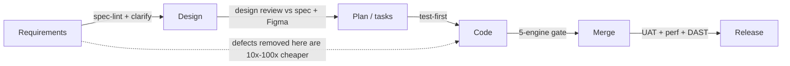

# eco-forge — Quality Assurance Model (prevention-first)

| | |
|---|---|
| **Status** | DRAFT — for review |
| **Date** | 2026-10-18 |
| **Principle** | Shift left: find defects in requirements and design, before code — so the code gates catch far fewer. Real tools decide; agents fix; humans sign off. |

## Why prevention first

A defect's cost rises by roughly an order of magnitude at each phase it survives: a wrong
requirement is cheapest to fix in the spec, dearer in design, dearer still in code, and most
expensive in production. eco-forge therefore spends most of its effort **before development** and
treats the build-time gates as a safety net, not the primary defence.

## Layer 0 — Prevent in requirements (NEW, proactive)

Before any design or code:
- **`/eco:clarify`** runs the fixed checklists (functional, NFR, integration, security/ASVS,
  DPDP, Figma) as a live interview, so gaps are closed by asking, not by guessing.
- **`eco-forge-spec-lint`** is a deterministic requirement-defect gate. It fails the spec (exit 2)
  on the defect classes that cause most downstream bugs:

  | Defect class | What it catches | Why it matters |
  |---|---|---|
  | ambiguous | "fast", "scalable", "user-friendly" with no number | un-testable → silent mis-build |
  | weak-nfr | an NFR with no numeric target | perf/availability bugs found only in prod |
  | untestable | "should work properly" acceptance criteria | nothing to test against |
  | missing-error-path | a flow with no failure behaviour anywhere | the #1 source of corner-case bugs |
  | unclassified-data | a data field with no PII class | DPDP breach risk designed-in |
  | conflict | duplicate/again contradicting REQ-IDs | ambiguous truth → divergent code |
  | tbd | an unresolved placeholder | building on an unknown |

  The product-analyst agent reviews each flag; blocking classes must be resolved before design.

## Layer 1 — Prevent in design

- `/eco:design` requires every design section to cite the REQ-IDs it realises; a requirement with
  no design, or a design with no requirement, is a gap caught here.
- The Figma-vs-spec checklist finds missing screen states (empty/loading/error/disabled),
  accessibility issues and scope creep before a component is built.
- ADRs record the trade-offs, so a design defect is visible and reviewable, not implicit.
- **`eco-forge-design-lint`** is a deterministic design-defect gate (exit 2) covering:
  requirements with no design coverage, design citing an undeclared requirement, OpenAPI
  operations missing error responses or security, and decisions with no ADR.

## Layer 2 — Prevent in construction

- **Test-first:** the failing test is written before the code, so every requirement ships with an
  executable definition of correct.
- **Path-scoped rules** (`.claude/rules/`) put the coding standards in front of the agent as it
  writes (deny-by-default security, idempotent Kafka consumers, no field injection, …), so whole
  classes of defect are never introduced.
- The **guard and PII hooks** stop unsafe actions and real PII at the point of action.

## Layer 3 — Detect at merge (the safety net)

Deterministic, blocking gates — a change merges only when the tools pass:
- **Correctness:** unit + integration (real Oracle + Kafka), contract tests, changed-line coverage.
- **Corner cases:** property-based tests, and **mutation testing** (proves the tests would catch a bug).
- **Security (5 engines on real output):** Semgrep (custom OWASP/DPDP/upload rules), SpotBugs +
  FindSecBugs, PMD, and Trivy **SCA with reachability triage** (upgrade / block-escalate /
  evidence-backed waiver / monitor).
- **Accessibility, performance (vs nfr.md), file-upload, DPDP (`pii-check`), traceability
  (`trace-check`).**
- **Waivers** need a named approver, reason and expiry — never silent.

## Layer 4 — Detect before release & prove the net works

- QA environments: SIT, performance (vs numeric NFRs), security (DAST, pen test), then UAT per REQ-ID.
- **The gates are themselves measured:** the planted-defect catalogue (catch rate) and mutation
  score answer "how do we know the gates catch things?" with a number, and any miss hardens a rule.

## What eco-forge can honestly claim

> Every known defect class has a preventive check and a detective gate; the preventive checks
> remove requirement/design defects before code; each detective gate's catch rate is measured; and
> nothing merges with a known unresolved defect of blocking severity.

It does **not** claim "defect-free" — no process can. It makes defects hard to introduce, cheap to
catch, and impossible to merge silently, with evidence at every step.

## Where this is proven today
- spec-lint + design-lint: 156-test suite; demos catch ambiguity/weak-NFR/conflict/unclassified-PII/TBD and untraced-requirement/missing-error-response/missing-auth/undocumented-decision.
- Gate catch rate: 8/8 on the planted-defect catalogue (Semgrep live; SCA + SpotBugs separately).
- SCA reachability: Log4Shell blocks; unused transitive waives with evidence.
