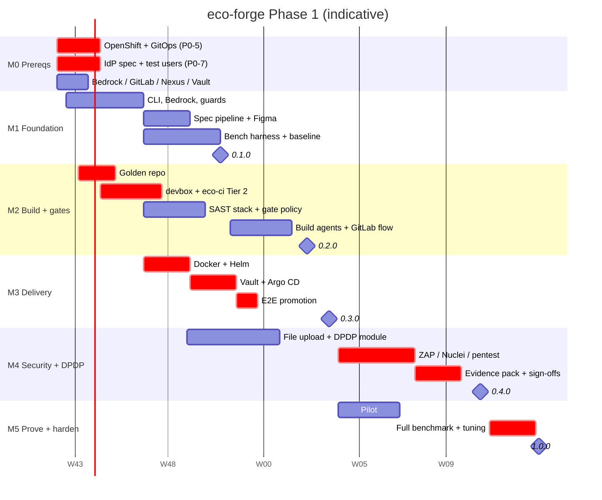

# eco-forge — Phase 1 Execution Plan

| | |
|---|---|
| **Companion to** | `docs/design/2026-10-18-eco-forge-design.md` |
| **Status** | DRAFT — for review |
| **Date** | 2026-10-18 |
| **Planned start** | Mon 2026-10-26 (week 1) |

---

## 1. Planning assumptions

### 1.1 Team (core, with AI-assisted development)

| Role | Code | FTE | Owns |
|---|---|---|---|
| Platform engineer (Node/TypeScript) | **PLT** | 1 | CLI, managed-file engine, hooks, bench harness, releases |
| AI/agent engineer | **AIE** | 1 | Agents, skills, commands, spec pipeline, memory, token techniques, evals |
| Java/security engineer | **SEC** | 1 | Golden repo, coding rules, SAST stack, file upload, DPDP module, red-team |
| DevOps/OpenShift engineer | **OPS** | 1 | devbox image, eco-ci, Docker/Helm, Argo CD, Vault, DefectDojo |
| Business analyst (part-time) | **BA** | 0.3 | Doc templates, sample BRDs, planted-gap corpus, UAT template |
| Security tester (part-time from week 12) | **PT** | 0.3 | Pen-test checklist validation, security sign-off |
| Legal / DPO (on call) | **LGL** | — | DPDP obligations, retention periods, evidence-pack review |
| Client platform teams | **EXT** | — | AWS, GitLab, Nexus, OpenShift, Vault, IdP provisioning |

Claude (this assistant) works alongside PLT, AIE, SEC and OPS. It writes code, tests, templates and scripts, and runs everything this container can run (see §6).

### 1.2 Estimates

- **Effort is in working days for one person with AI assistance.** These are planning estimates with an expected ±30% spread, re-calibrated after sprint 1.
- Sprints are 2 weeks; one week is 5 working days.
- **External lead times (EXT) are assumptions.** They are the largest schedule risk (§5).

---

## 2. Milestone summary

| Milestone | Weeks | Release | Outcome |
|---|---|---|---|
| **M0: Prerequisites** | 0–2 | — | Access and environments provisioned |
| **M1: Foundation** | 1–8 | `0.1.0` (next) | CLI, Bedrock, guards, spec pipeline, Figma A/B, bench baseline |
| **M2: Build + gates** | 3–12 | `0.2.0` (next) | Build agents, GitLab flow, Tier 1/2 gates, SAST scorecard, onboarding |
| **M3: Delivery** | 5–14 | `0.3.0` (next) | Docker/Helm/Vault/Argo CD; golden repo promoted Dev → Pre-prod |
| **M4: Security + DPDP** | 6–18 | `0.4.0` (next) | DAST, pen-test assistant, DefectDojo, file upload, DPDP, evidence pack |
| **M5: Prove + harden** | 13–22 | **`1.0.0` (stable)** | Pilot, full benchmark, tuning, docs/training, stable release |

**Indicative total: ~22 weeks.** It shortens if M0 is ready by week 1, and stretches if OpenShift/Vault/IdP provisioning slips.

---

## 3. Detailed task list

Legend:
- **Dep** = predecessor tasks.
- **★** = on the critical path; **◆** = near-critical (≤ 1 week of slack).
- **Acceptance** = the objective done-check.

### M0: Prerequisites (external, start immediately)

| ID | Task | Owner | Est | Dep | Acceptance |
|---|---|---|---|---|---|
| P0-1 ◆ | Bedrock access in **ap-south-1**; SSO profile; list of Claude models invocable **in-region** | EXT + PLT | 3 | — | `aws bedrock-runtime invoke-model` succeeds for each tier model in ap-south-1 |
| P0-2 | GitLab group + projects (`eco-forge`, `eco-ci`, `eco-devbox`, `env-config`, `golden-repo`), PAT/bot user for MCP | EXT | 3 | — | Projects exist; bot can create issues/MRs via API |
| P0-3 | GitLab runners: Linux runner on a **VM with Docker/Podman** (Testcontainers needs it — OpenShift-hosted runners usually can't); one Windows runner | EXT + OPS | 5 | P0-2 | A sample job runs Testcontainers Oracle Free and passes |
| P0-4 | Nexus: hosted npm repo for `@yourorg`; proxy repos for npm, Maven, container images | EXT | 2 | — | `npm publish` to the hosted repo works; Maven/npm resolve through Nexus |
| P0-5 ★ | OpenShift: namespaces dev, sit, perf, sec, uat, preprod (prod later) + `eco-tools`; OpenShift GitOps operator; quotas; image pull access | EXT | 10 | — | Argo CD can sync a hello-world app into each namespace |
| P0-6 ◆ | Vault: k8s auth per namespace, KV paths, transit key for field encryption | EXT | 5 | P0-5 | A pod in dev reads a test secret through VSO/ESO |
| P0-7 ★ | In-house IdP spec + test client + test users per role for QA-Security | EXT | 10 | — | Token obtainable for each test role from QA-Security |
| P0-8 | Inputs: 3+ real-world sample BRDs (sanitised), one Figma sample file, a DPDP legal contact | BA + EXT | 5 | — | Files in `golden-repo/inputs/`; legal reviewer named |
| P0-9 | Test workstations: one Windows 11 (WSL2 + Podman Desktop), one Linux, both behind the corporate proxy | EXT | 3 | — | Node 20+, Java 21 and Git work through the proxy |

### M1: Foundation (weeks 1–8)

| ID | Task | Owner | Est | Dep | Acceptance |
|---|---|---|---|---|---|
| M1-01 | Repo scaffold: TS workspace (`cli`, `templates`, `scripts`), ESLint, Vitest, own GitLab CI (lint, test, Semgrep, gitleaks, audit, SBOM) | PLT | 2 | P0-2 | Pipeline green on an empty skeleton |
| M1-02 | CLI core: `init` with profile detection, template rendering, dry-run, idempotent re-run, proxy/Nexus honoured | PLT | 4 | M1-01 | Snapshot tests for `springboot-angular`; re-run produces no diff |
| M1-03 ◆ | `doctor`: tool versions, proxy/Nexus reachability, **Bedrock in-region model check**, MCP health | PLT | 3 | M1-02, P0-1 | Fails clearly on a missing tool, a wrong region or a cross-region model ID |
| M1-04 ◆ | Bedrock configuration + model-tier map + `managed-settings.json` install (Windows and Linux paths) | PLT | 3 | M1-03 | Claude Code starts on both OSes using Bedrock ap-south-1 only |
| M1-05 | Guard hook: deny rules + command normaliser (`sh -c`, scripts, aliases, path tricks) | PLT | 5 | M1-02 | Blocks kube/aws/Vault/`.env` access, non-Dev `oc`, force-push |
| M1-06 | PII guard: Aadhaar (Verhoeff), PAN, phone, email, bulk-dump heuristics; synthetic data generator | PLT | 4 | M1-05 | Detects test fixtures; generator output is marked as fake and passes checksums |
| M1-07 | Audit logger (JSONL), budget guard (turns/cost), OpenTelemetry config | OPS | 3 | M1-05 | Every tool call is logged; a session over budget is stopped |
| M1-08 | Guard red-team suite (bypass attempts → regression tests) | SEC | 3 | M1-05, M1-06 | All known bypasses blocked; suite runs in CI |
| M1-09 | Doc templates: BRD, PRD, HLD, LLD, tech spec, integration, API, UAT, ADR, RCA, DPDP notice, RoPA | BA + AIE | 4 | M1-01 | Reviewed by BA; each template has required-section markers |
| M1-10 | Clarify checklists (functional, ISO 25010 NFR, integration, security/ASVS, DPDP, Figma) as skill references | AIE | 4 | M1-01 | Every checklist item maps to a question pattern and a spec field |
| M1-11 | REQ-ID schema + spec front-matter schema; `trace-check` script | AIE | 3 | M1-10 | Orphan REQ-IDs fail the check |
| M1-12 ◆ | Spec agents + commands: `/eco:intake`, `/eco:clarify` (live interview → `questions.md`), `/eco:spec`, `/eco:design`, `/eco:plan` (local `tasks.md`), `/eco:uat` | AIE | 8 | M1-04, M1-09, M1-10 | End-to-end run on one sample BRD produces every artifact; blocking-question gate enforced |
| M1-13 | `/eco:export`: pandoc → branded DOCX/PDF, Mermaid rendering | AIE | 3 | M1-09 | DOCX/PDF open correctly in Word; diagrams rendered |
| M1-14 ◆ | Figma route A (MCP, selected nodes) and route B (token JSON + frame PNGs → `ui-inventory.md`); `/eco:figma` | AIE | 5 | M1-12, P0-8 | Both routes produce `design-review.md` for the sample Figma file |
| M1-15 | Token techniques: context-mode MCP, terse subagent output style, model routing, spec slicing | AIE | 4 | M1-12 | Each technique can be toggled for ablations |
| M1-16 | Memory tier: CLAUDE.md template, path-scoped rules, `docs/memory/`, `/eco:retro`, claude-mem adapter **verified Bedrock-only** | PLT | 4 | M1-04 | Network capture shows no non-Bedrock LLM calls; otherwise the adapter is disabled |
| M1-17 ◆ | Bench harness: task runner (`claude -p --output-format json`), arms/ablations, k repetitions, metrics collector, `bench-report.md` | PLT | 6 | M1-04 | Runs a 3-task smoke suite in two arms and produces a report |
| M1-18 | Planted-gap spec corpus (≥ 5 BRDs, ≥ 40 planted gaps with answer key) | BA | 4 | P0-8 | Answer key reviewed by AIE |
| M1-19 ◆ | **Baselines:** spec-gap recall; token use vanilla vs eco-forge on spec tasks; **Figma A vs B decision** | AIE | 4 | M1-14, M1-15, M1-17, M1-18 | `bench-report-m1.md` published; Figma default chosen from data |
| M1-20 | Managed-file engine: hash markers, three-way merge `upgrade`, `.eco/overrides`, `eject`; `eco.lock` schema + resolver | PLT | 6 | M1-02 | Upgrade-with-local-edits test matrix passes |
| M1-21 ◆ | Install verification on Windows + Linux behind proxy/Nexus; publish **0.1.0** to the `next` channel | PLT | 3 | M1-19, M1-20, M1-08, P0-4, P0-9 | Clean install on both machines; `doctor` green |

### M2: Build + Tier 1/2 gates (weeks 3–12)

| ID | Task | Owner | Est | Dep | Acceptance |
|---|---|---|---|---|---|
| M2-01 | Golden repo: Spring Boot 4 / Java 21 / Maven + Angular + Flyway (Oracle) + Kafka + IdP adapter (stub until P0-7) + H2/Postgres AI-env profile | SEC | 8 | M1-01 | Builds and runs locally; Oracle Free Testcontainers tests pass |
| M2-02 | Planted-defect catalogue + seeding (SQLi, XSS, IDOR, SSRF, upload, PII-in-logs, missing retention, root container, N+1, a11y, missing NFR) | SEC | 4 | M2-01 | Each defect documented with the expected detecting gate |
| M2-03 | Coding-standard rules (`.claude/rules/`): backend, Angular, Kafka, DB/Oracle, security | SEC + AIE | 4 | M1-02 | Rules load by path; reviewed by SEC |
| M2-04 ★ | `eco-devbox` image (UBI 9; Java 21, Maven, Node, oc, helm, Semgrep, Infer, SpotBugs, Trivy, gitleaks, ZAP, k6, pandoc; pinned) | OPS | 5 | P0-3, P0-4 | Image digest recorded in `eco.lock`; runs on WSL2/Podman and on the CI runner |
| M2-05 ★ | `eco-ci` Tier 2 templates: build/test (Testcontainers), JaCoCo, PIT, Angular tests + Stryker, Playwright + axe, Lighthouse CI | OPS | 8 | M2-04, M2-01 | Golden-repo MR pipeline runs all jobs |
| M2-06 | SAST stack: Infer, SpotBugs + FindSecBugs, PMD, Error Prone/NullAway, Semgrep CE + eco rules, SonarQube CE, ESLint security | SEC | 6 | M2-04 | All tools emit SARIF/JSON in CI |
| M2-07 | SCA/SBOM/container/IaC: Trivy, Dependency-Check, Syft, Checkov, hadolint, gitleaks | OPS | 3 | M2-04 | Findings emitted as SARIF/JSON |
| M2-08 ◆ | `sarif-reduce` (new-only, de-dup), `eco.gates.yaml`, `gate-policy` (waivers with approver + expiry) | PLT | 5 | M2-06, M2-07 | MR blocked by a new High finding; an approved waiver unblocks it |
| M2-09 | Build agents: backend-dev, frontend-dev, test-designer, code-reviewer, security-reviewer, deep-taint-reviewer (with tool allowlists) | AIE | 6 | M2-03, M1-04 | Agents restricted to their allowlists (verified by test) |
| M2-10 | GitLab MCP config, issue/MR templates, `labels.json`, label-lint job | OPS | 3 | P0-2 | Labels created by `init`; lint job passes |
| M2-11 ◆ | `/eco:plan` → GitLab issues; `/eco:dev`, `/eco:bugfix`, `/eco:status` | AIE | 6 | M2-09, M2-10, M1-12 | One story implemented on the golden repo from issue to MR |
| M2-12 | Tier 1 hooks + pre-commit (Spotless, Prettier, Checkstyle, PMD, angular-eslint, gitleaks) | PLT | 4 | M2-01, M1-05 | Bad formatting/lint is fixed or blocked before commit |
| M2-13 | `sast-triager` + headless gate auto-fix CI job (max N attempts, never merges) | AIE | 4 | M2-08, M2-09 | A planted lint/security failure is fixed by a bot commit |
| M2-14 | **OWASP Benchmark** run → scorecard with and without deep-taint-reviewer | SEC | 4 | M2-06, M2-09 | `owasp-benchmark-scorecard.md` published |
| M2-15 | `/eco:onboard` (reverse-engineer docs, rules, baseline mode) | AIE | 6 | M2-08, M1-12 | Run on one existing internal repo; only new findings block |
| M2-16 ◆ | **Golden-repo catch rate** + **agent pass-rate baseline** (stories/bugs task set, k runs) | AIE + SEC | 5 | M2-02, M2-05, M2-08, M2-11, M1-17 | `bench-report-m2.md` published |
| M2-17 | Release **0.2.0** (`next`) | PLT | 1 | M2-16 | Published; changelog |

### M3: Delivery (weeks 5–14)

| ID | Task | Owner | Est | Dep | Acceptance |
|---|---|---|---|---|---|
| M3-01 ★ | Dockerfiles: backend (UBI 9 JRE) and frontend (UBI nginx-unprivileged), non-root, arbitrary UID, read-only root filesystem | OPS | 3 | M2-01 | hadolint clean; runs under `restricted-v2` SCC |
| M3-02 ★ | Helm chart (Deployment, Service, Route, HPA, PDB, NetworkPolicy, ConfigMap, SA, probes, limits) + values per environment | OPS | 6 | M3-01 | `helm template` passes kubeconform (OpenShift schemas) and kube-linter |
| M3-03 | OpenShift lint gates wired into eco-ci | OPS | 2 | M3-02, M2-07 | Root container or missing probes fail the MR |
| M3-04 ★ | Vault integration (VSO/ESO manifests, per-env paths, transit key for PII encryption) | OPS | 4 | M3-02, P0-6 | Golden repo reads secrets in dev; none in git |
| M3-05 ★ | `env-config` repo + Argo CD ApplicationSet + promotion job (digest-bump MR) + cosign signing | OPS | 6 | M3-02, P0-5 | Merge to main → image signed → digest MR to dev → Argo CD syncs |
| M3-06 ★ | **End-to-end promotion** of the golden repo: Dev → SIT → Perf → Sec → UAT → Pre-prod; rollback drill | OPS | 5 | M3-04, M3-05, M2-05 | Same digest in every env; rollback by revert MR verified |
| M3-07 | k6 thresholds generated from `nfr.md`; `perf-engineer` agent; QA-Perf job | SEC + AIE | 4 | M3-06, M1-12 | A missed NFR threshold blocks promotion |
| M3-08 | Release **0.3.0** (`next`) | PLT | 1 | M3-06 | Published |

### M4: Security + DPDP (weeks 6–18)

| ID | Task | Owner | Est | Dep | Acceptance |
|---|---|---|---|---|---|
| M4-01 | DefectDojo + Dependency-Track in `eco-tools`; CI import; baseline + SLA config | OPS | 5 | P0-5, M2-08 | Findings from a golden-repo MR visible in DefectDojo |
| M4-02 ◆ | File-upload module + attack suite (polyglot, double extension, SVG script, zip bomb, traversal, oversize); ClamAV service | SEC | 6 | M2-01 | All attack cases rejected; module installs via `eco-forge add file-upload` |
| M4-03 ◆ | DPDP module: consent ledger, `@Pii` masking/encryption (Vault transit), retention/erasure jobs, data-principal APIs, breach runbook hook | SEC | 10 | M2-01, M3-04 | Integration tests green against Oracle Free; keys from Vault in dev |
| M4-04 ◆ | `pii-check`, `retention-check` gates + privacy-reviewer agent + `data-catalog` link | SEC + AIE | 4 | M4-03, M2-08 | Planted PII defects in the golden repo are caught |
| M4-05 ★ | ZAP baseline, OpenAPI-driven API scan, **authenticated full scan** (IdP test users) in QA-Security | SEC | 5 | M3-06, P0-7 | Scan results in DefectDojo; planted web vulnerabilities found |
| M4-06 ★ | Nuclei + sqlmap/ffuf; **scope lock** (guard hook + allowlisted hosts) | SEC | 4 | M4-05, M1-05 | Tools refuse non-QA-Security hosts (verified by test) |
| M4-07 ★ | `pentest-assistant` agent + ASVS L2 checklist + evidence capture | SEC + AIE | 6 | M4-06 | Checklist run produces per-item evidence; PT validates sample items |
| M4-08 | WebGoat DAST benchmark | SEC | 3 | M4-05 | `dast-benchmark.md` published |
| M4-09 ★ | ASVS L2 mapping + evidence-pack generator (ASVS, Top 10, file upload, DPDP RoPA, DefectDojo export) | SEC | 5 | M4-07, M4-04, M4-01 | Pack generated for the golden repo |
| M4-10 ★ | **QA-Security gate run** on the golden repo + PT sign-off + **legal review** of the DPDP evidence | SEC + PT + LGL | 5 (+ legal lead time) | M4-09, M4-08 | Sign-off recorded; legal comments resolved |
| M4-11 | Release **0.4.0** (`next`) | PLT | 1 | M4-10 | Published |

### M5: Prove + harden (weeks 13–22)

| ID | Task | Owner | Est | Dep | Acceptance |
|---|---|---|---|---|---|
| M5-01 | **Pilot** with one real feature team on `0.3.x` → `0.4.x` (1–2 sprints), with feedback triage | AIE + all | 10 (elapsed) | M3-08 | Pilot retro; top issues fixed |
| M5-02 | Compatibility matrix CI (Claude Code pinned and N-1 × Windows/Linux) + `next`→`stable` promotion rule | PLT | 3 | M1-21 | Matrix green; promotion blocked on bench regression |
| M5-03 ★ | **Full benchmark**: all arms + ablations, k runs, stories/bugs/spec tasks, Figma | AIE + PLT | 6 | M2-16, M4-10 | `bench-report-v1.md`: tokens per passing task, pass rate, cost |
| M5-04 ★ | Tuning: gate thresholds from the measurements; remove token techniques with no net benefit | AIE + SEC | 4 | M5-03, M5-01 | Changes documented in the decisions log |
| M5-05 | Docs + training: install guide, command reference, role playbooks (PO/BA/Dev/QA/Sec/Ops), 2 training sessions | BA + AIE | 5 | M4-11 | Training delivered; guide reviewed |
| M5-06 ★ | **Release 1.0.0 (stable)** + ownership hand-over (eco-forge, eco-ci, eco-devbox) | PLT | 2 | M5-04, M5-02, M5-05 | Published to Nexus `stable`; owners named |

---

## 4. Critical path

### 4.1 The path

The path that sets the end date runs through **infrastructure and the security environment**, not through the CLI:

```
P0-5 OpenShift namespaces + GitOps (EXT, 10d)
  └─► M2-04 devbox image ─► M2-05 eco-ci Tier 2 ─┐
      M2-01 golden repo ─► M3-01 Dockerfiles ─► M3-02 Helm ─► M3-04 Vault ─┐
                                                       └─► M3-05 Argo CD ─┴─► M3-06 E2E promotion to QA-Security
P0-7 IdP spec + test users (EXT, 10d) ──────────────────────────────────────────┐
  M3-06 ─► M4-05 authenticated ZAP ─► M4-06 Nuclei + scope lock ─► M4-07 pentest assistant
       ─► M4-09 evidence pack ─► M4-10 QA-Security run + PT + legal sign-off
       ─► M5-03 full benchmark ─► M5-04 tuning ─► M5-06 v1.0.0
```

### 4.2 Gantt (indicative)



### 4.3 Near-critical chains (≤ 1 week of slack)

| Chain | Why it matters |
|---|---|
| **P0-1 Bedrock → M1-03 → M1-04 → M1-12 spec pipeline → M1-14 Figma → M1-19 baseline → M1-21 0.1.0** | Nothing agentic can be tested until Bedrock works in ap-south-1. If the in-region model list is limited, agent tiers and the spec pipeline need rework. |
| **M2-01 golden repo → M4-03 DPDP module (10d) → M4-04 → M4-09 evidence pack** | DPDP is the longest single build task, and it also needs Vault (M3-04). |
| **M2-08 gate-policy → M2-16 bench baseline → M5-03** | Every later measurement depends on the gates producing clean, new-only findings. |

---

## 5. Schedule risks and mitigations

| # | Risk | Impact on path | Mitigation |
|---|---|---|---|
| R1 | OpenShift namespaces / GitOps / Vault provisioning is late | Direct slip of M3 → M4 → v1 | Request in week 0; until ready, develop Helm/Argo CD against a local kind/OpenShift Local (CRC) cluster; manifest-level gates don't need the cluster |
| R2 | IdP spec / test users are late | Authenticated DAST and pen testing blocked | Build the IdP adapter against a stub OIDC provider (Keycloak) in the AI env; swap when the spec arrives |
| R3 | Claude models are limited in ap-south-1 | Agent quality/cost assumptions change | Verify in week 1 (P0-1); model tiers are configurable; re-plan M1-12 if needed |
| R4 | Testcontainers can't run on CI runners | Tier 2 gates incomplete | VM-based runner with Docker/Podman (P0-3); verified in week 1 |
| R5 | Legal review of DPDP evidence takes weeks | M4-10 → v1 slip | Engage LGL in week 2 with the data-catalog design; review the module design before the evidence pack, not only after |
| R6 | Corporate proxy blocks scanner rule/DB downloads | Gates fail or go stale | Pre-bake rules/DBs into `eco-devbox`; mirror through Nexus raw repos |
| R7 | Pilot surfaces significant workflow rework | M5 slip | Pilot starts at week 13 on 0.3.x, overlapping M4, so feedback arrives before tuning |
| R8 | Claude Code release changes hook/agent behaviour mid-project | Rework | Pinned in `eco.lock`; upgrade only through the compatibility matrix (M5-02, built early as a smoke check in M1) |

---

## 6. What Claude can execute in this development container

| Work | Here | Needs your environment |
|---|---|---|
| CLI, templates, hooks, scripts, unit/snapshot tests, guard red-team | ✅ | — |
| Golden repo build + tests (Java 21, Maven, Node), scanners, OWASP Benchmark | ✅ if network/proxy allows the downloads | — |
| Helm/Docker manifest validation (kubeconform, kube-linter, hadolint) | ✅ | Real cluster for M3-06 |
| Agent runs and token benchmark | Only if Claude credentials are provided here | ✅ Bedrock via `eco-forge bench` |
| GitLab issue/MR flow, runners, Argo CD, Vault, DefectDojo | ❌ | ✅ |

---

## 7. Sprint 1 (weeks 1–2): start immediately

1. **EXT/PLT:** raise all M0 requests on day 1 (P0-1…P0-9). Track them daily; these are the critical-path inputs.
2. **PLT:** M1-01 scaffold → M1-02 CLI core → M1-03 `doctor` (as soon as Bedrock is available).
3. **AIE:** M1-10 clarify checklists; draft the spec agents' prompts (M1-12, not blocked on Bedrock for authoring).
4. **SEC:** M2-01 golden-repo skeleton (critical-path feeder for M3).
5. **OPS:** P0-3 runner with Testcontainers proof; start M2-04 `eco-devbox`.
6. **BA:** M1-09 templates review; collect sample BRDs (P0-8); start the planted-gap corpus (M1-18).

**Sprint 1 exit criteria:**
- CLI `init` produces a valid `.claude/` for the profile.
- `doctor` runs.
- The golden repo builds with Oracle Free Testcontainers.
- The devbox image builds.
- Status of every M0 request is known (date committed or escalated).
